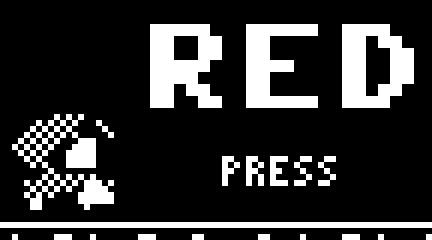
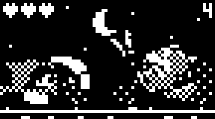
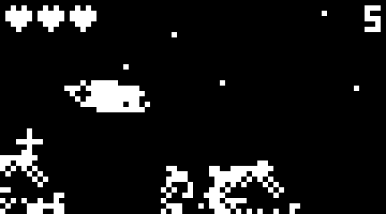
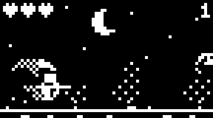
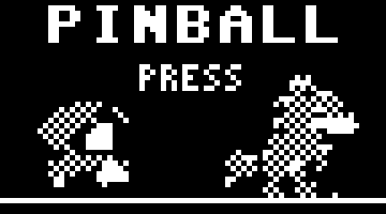

# RED runner

Five one-button games for the tiny ESP32-C3 board with a 0.42" 72x40 OLED, written in
MicroPython. The only control is the board's BOOT button; nothing else is wired up.

| | |
|---|---|
|  |  |
|  |  |
|  | |

## The games

- **RED RUN**: an endless runner. Tap to jump mushrooms and brambles and stay under the ravens;
  the first stumble brings the wolf close, the second one ends it.
- **WOLF DUEL**: whack the beast out of its attack with the basket. The wolf leaps after a
  "!", the boar backs off and charges, the bear needs two blows. Swinging at nothing costs a bite.
- **LOST WISP**: hold to rise, let go to sink. Thread the thorn thickets, go over or under the
  ravens, and pick up motes; every eighth mends a heart.
- **HUNTSMAN**: ravens fly a rolling path and can only be hit while they dip into the arrow's
  line, and the arrow is slow, so lead them. A boar that takes two arrows comes after every six.
- **PINBALL**: a table three screens tall that scrolls with the ball. Hold to wind up the
  launch; after that the button works both flippers. Knock down a bank of drop targets to wake
  the wisp on that side, wake both to light the moon, hit the moon for the jackpot.

On a menu screen (the game list, or a game's title and game-over screens) a tap is that
screen's action and holding the button for three quarters of a second is the other one: play
the game shown, or go back to the list. Best scores are kept on the board.

## The board

Sold as "ESP32-C3 0.42 inch OLED" (ABrobot and others): ESP32-C3FH4 with 4 MB flash, an
SSD1306 on I2C address 0x3C (SDA GPIO 5, SCL GPIO 6), the BOOT button on GPIO 9 and an LED on
GPIO 8.

The 72x40 glass is a window into the controller's 128x64 memory. On this board it starts at
column 28 and row 24, not at the (30, 12) that most example code uses; with those the picture
is cut off. `oled.py` sets the controller up for the full 128x64, moves the start line so the
window is the first five pages, and sends each frame as one 360-byte write. `ROTATED` in that
file turns the picture upside down (USB socket at the top).

## Putting it on a board

Flash MicroPython for the ESP32-C3 (the `ESP32_GENERIC_C3` image from micropython.org, written
at address 0), then copy the files and reset:

```bash
uvx mpremote connect /dev/cu.usbmodemXXXX cp *.py pinball.bin :
```

```bash
uvx mpremote connect /dev/cu.usbmodemXXXX reset
```

## How it is put together

- `app.py` is the game list and the 60 Hz loop; it loads one game at a time and unloads it
  again. `engine.py` has what the games share: sprites, a 3x5 font, the night backdrop.
- Each game is one module with a `Game` class that never touches the hardware, so the same
  code runs on a computer under MicroPython's unix port.
- `sprites_<game>.py` are generated by `tools/convert.py` from the colour sprite sheets of
  the game these characters come from (not in this repository): every colour becomes off,
  a checker pattern or on, by brightness.
- `tools/table.py` draws the pinball table and writes `pinball.bin`: the wall art, and a map
  that tells the game, for every pixel, whether the ball is blocked there and which way the
  surface faces.
- `tools/sim.py` plays the games with a bot on the button. `fair` checks that a bot playing
  perfectly is never hit, `frames` dumps the screen, and `tools/frames.py` turns a dump into a
  PNG sheet or a GIF. That is how the games were checked without watching the panel.

```bash
micropython tools/sim.py fair duel
```

```bash
micropython tools/sim.py frames pinball out.bin 1200 2
```

## Licence

MIT, see [LICENSE](LICENSE).
